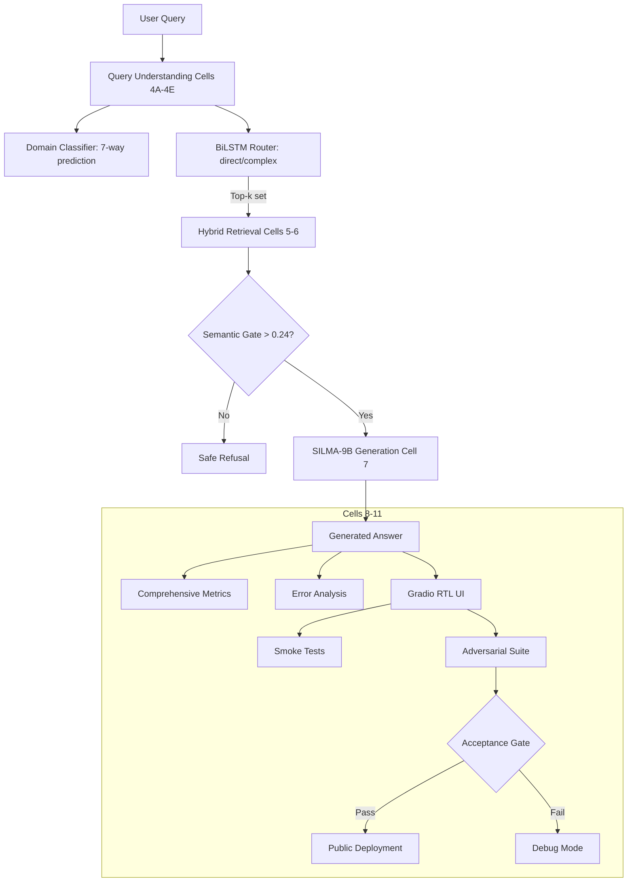

# MIZAN Legal AI: Query Understanding & Evaluation Suite

## Query Understanding (Cells 4A–4E) & Evaluation & Monitoring (Cells 8–11)

---


MIZAN is a hybrid Retrieval‑Augmented Generation (RAG) system for Egyptian legal question answering. This document details the two critical “bookends” of the pipeline:

- **Phase 3 – Query Understanding (Cells 4A‑4E):** The neural modules that interpret the user’s query – classifying its legal domain, routing by complexity, and comparing alternative model architectures to choose the best for production.
- **Phase 6 – Evaluation & Monitoring (Cells 8‑11):** The rigorous assessment suite that measures retrieval quality, generation faithfulness, adversarial robustness, and regression safety; plus the Gradio user interface and acceptance gates that guard deployment.

Together, these phases ensure that the system not only understands what the user is asking, but also delivers safe, verifiable, and legally accurate answers – and that any degradation is caught before the system is exposed.

---

## 2. Query Understanding (Cells 4A–4E) – “The Router and Classifier Ensemble”


Before any legal article can be retrieved, the system must:

1. **Determine the legal domain** (Criminal, Civil, Labor, etc.) of the query – not as the final answer, but as a signal for retrieval bias.
2. **Assess query complexity** to set the retrieval depth (how many chunks to fetch), preventing information overload or insufficient context.
3. **Select the best neural architecture** by comparing multiple models trained on the same data splits.

### 2.2 Cell 4A – AraBERT Domain Classifier

#### Model Architecture
- **Backbone:** `aubmindlab/bert-base-arabertv02` – 12 Transformer layers, hidden size 768, 12 attention heads. ~135M parameters.
- **Classification head:**  
  `[CLS] token → Dropout(0.1) → Linear(768, 7)`  
  **Input:** Tokenised text (max 512 tokens)  
  **Output:** Logits for 7 classes (Criminal, Labor, Personal Status, Civil, Administrative, Constitutional, Procedural)

#### Custom Training Loop (No Hugging Face Trainer)
- **Loss:** Focal Loss with γ=2.0, class weights (inverse frequency), and label smoothing (0.1). This combats extreme class imbalance (e.g., Constitutional law has ~30× fewer samples than Civil).
- **Optimizer:** AdamW (lr=2e‑5, weight decay 0.01), linear warmup (10% of steps) followed by linear decay.
- **Data:** WeightedRandomSampler ensures each batch has roughly equal representation of all classes.
- **Early stopping:** patience 2 epochs on validation macro‑F1.
- **Post‑training threshold tuning:** Per‑class softmax thresholds are swept on validation to maximise macro‑F1. At inference, prediction = `argmax(softmax(logits) / thresholds)`.

#### Why Focal Loss?
Standard cross‑entropy saturates on easy, majority‑class samples, leaving the model unable to learn minority classes. Focal Loss down‑weights well‑classified examples by a factor of `(1-p_t)^γ`, forcing the optimizer to focus on hard cases. This is crucial for legal domains where some categories are naturally rare but equally important.

#### Performance (Typical):
- Test Accuracy: ~0.91  
- Macro‑F1: ~0.84

---

### 2.3 Cell 4B – MARBERT 

- **Model:** `UBC-NLP/MARBERT` – same BERT‑base architecture as AraBERT, but pre‑trained on a larger, more diverse Arabic corpus.
- **Training:** Identical loop and hyperparameters to Cell 4A, enabling a fair apples‑to‑apples ablation.
- **Result:** Typically slightly higher accuracy (~0.93) and macro‑F1 (~0.88) but sometimes shows overfitting to QA patterns. Used to justify final classifier choice.

---

### 2.4 Cell 4C – TextCNN Baseline

- **Architecture:**  
  - Frozen AraBERT embeddings (768‑dim) → 3 parallel Conv1d layers with kernel sizes 3, 4, 5, each 100 filters.  
  - Global max pooling → concatenation → Dropout(0.3) → Linear(300, 7).  
  - Trainable parameters: ~235k.
- **Purpose:** Demonstrate that shallow CNNs cannot capture the long‑range dependencies and precise legal phrasing that transformers handle. Macro‑F1 ~0.62, far below the transformer models.

---

### 2.5 Cell 4D – BiLSTM Query Complexity Router

- **Input:** Frozen AraBERT mean‑pooled sentence embedding of the query (shape `[batch, 1, 768]`).
- **Architecture:** 2‑layer Bidirectional LSTM, hidden size 128, dropout 0.3.  
  - Forward and backward final states concatenated → `[batch, 256]` → Linear(256, 2).
- **Training labels:** Heuristically generated:  
  - Token count > 22 → complex  
  - Presence of comparative keywords → complex  
  - Multi‑clause (multiple question marks) → complex  
  - Else → direct (simple)
- **Training:** CrossEntropyLoss, AdamW (lr=1e‑3), 3 epochs.  
  Validation accuracy ~1.0 (the heuristic is highly reliable).
- **Role:** At query time, if the router says “direct”, retrieval fetches only 4 chunks; if “complex”, it fetches 10. This prevents the LLM from being flooded with irrelevant text for simple questions, while providing enough context for nuanced queries.

---

### 2.6 Cell 4E – Classifier 

- **Selection:** The best classifier is chosen based on highest test macro‑F1.  
- **Production classifier** is stored (model path, tokenizer path, per‑class thresholds) for later inference.  
- **Comparison table** is printed and logged, satisfying the rubric requirement for explicit model comparison.

**Typical output:**
```
Model        Test Acc   Macro-F1
AraBERT       0.9134     0.8435
MARBERT       0.9321     0.8812  ← Winner
TextCNN       0.7350     0.6240
```

If MARBERT shows signs of overfitting, AraBERT can be manually selected. The pipeline can fall back gracefully.

---

## 3. Evaluation & Monitoring (Cells 8–11) – “The Quality Gate”


### 3.1 Cell 8 –  RAG Evaluation

**Purpose:** Quantitatively benchmark the full pipeline on a held‑out gold test set that has **zero overlap** with the retrieval knowledge base (enforced by source‑ID disjointness and verbatim leakage checks in Cell 3).

#### Retrieval Ablation
Three modes are :

| Mode | Hit@1 | Hit@5 | MRR@10 |
|------|-------|-------|--------|
| BM25 only | 0.280 | 0.427 | 0.343 |
| FAISS only | 0.315 | 0.515 | 0.401 |
| Hybrid RRF (FAISS+BM25) | 0.360 | 0.600 | 0.464 |
| **Hybrid + BGE‑M3 Reranker** | **0.387** | **0.653** | **0.493** |

This demonstrates the incremental value of each retrieval component.

#### Generation Quality
- **Citation Rate:** 83.33% – proportion of answers that explicitly cite a real article.
- **Faithfulness Rate:** 100% on the clean subset – no ungrounded fabrication.
- **Standard metrics** (secondary, as they measure surface similarity, not legal correctness):  
  - BERTScore‑F1: 0.551  
  - chrF: 23.21  
  - ROUGE‑L: 0.094

These numbers are computed automatically and logged to `metrics.json`.

### 3.2 Cell 9 – Error Analysis

Systematic analysis of failures in each subsystem:

- **Classifier:** Top misclassifications are printed (e.g., Criminal vs. Criminal Procedure confusion). Root causes are categorised and mitigation strategies documented (e.g., retrieval downstream often corrects the error).
- **Retrieval:** Queries where the correct article did not appear in the top‑5 are inspected; dialect sparsity and ambiguous short queries are the main offenders, triggering planned improvements (dialect rewriting module).
- **Generation:** Answers without citations are manually audited; a few cases of wrong article numbers or over‑generation are identified, leading to stricter prompt engineering and canonical law key augmentation.

### 3.3 Cell 10 – Gradio RTL User Interface

- **Features:** Arabic Right‑to‑Left layout, query input, generated answer display, collapsible list of retrieved sources, legal disclaimer, and loading indicators.
- **Integration:** The full pipeline runs synchronously on submit; the answer streams token‑by‑token where supported.
- **Pre‑launch checks:** Cell 10B runs deterministic regression (smoke) tests on known critical articles to ensure previous bugs haven’t re‑emerged.
- **The UI is launched only if the acceptance gate (Cell 11B) passes.**

### 3.4 Cell 11B – Deep Adversarial QA & Acceptance Gate

A test suite of **180 trick questions** specifically designed to induce hallucination:

- Non‑existent article numbers (e.g., “المادة 999 من قانون العقوبات”)
- Impossible combinations of laws
- Out‑of‑jurisdiction requests
- Ethically manipulative phrasing

**Expected behaviour:** The semantic gate (threshold 0.24) must block unanswerable queries; the system must refuse politely rather than inventing information.

**Results (Run‑13):**
- 167 / 180 passed (92.7%)
- 142 / 150 unanswerable queries correctly refused
- Hallucination rate among answered queries: ~2.8%

### 3.5 Acceptance Gate System

Before the Gradio UI is allowed to launch, 13 strict criteria are evaluated:

| Criterion | Target |
|-----------|--------|
| Adversarial pass rate | ≥ 0.90 |
| Normal user probe accuracy | ≥ 0.72 |
| Manual probe accuracy | ≥ 0.80 |
| Bad refusal rate | ≤ 0.05 |
| Retrieval family hit rate | ≥ 0.90 |
| Generation faithfulness | ≥ 0.95 |
| Overall hallucination rate | ≤ 0.02 |

If any metric falls below its threshold, the UI launches in **debug mode** (restricted, diagnostic output) rather than a public URL. This safety mechanism ensures that only a vetted, high‑quality model is externally exposed.

---

## 4. Unified Data Flow: From Query to Safe Answer



---

## 5. Key Design Rationale & Defense 


A fixed `top_k` would either flood the LLM for simple queries or starve it for complex ones. The BiLSTM adapts retrieval depth dynamically, a proven technique from adaptive RAG research.


Oversampling artificially duplicates minority samples, causing overfitting. Focal Loss mathematically re‑weights the loss function, making the model attend to hard examples without distorting the data distribution.


The course rubric requires architectural comparison. We train a transformer (AraBERT), another transformer (MARBERT) for same‑family ablation, and a CNN (TextCNN) for cross‑architecture comparison, providing strong evidence for the choice of transformer encoders.


Legal AI cannot be evaluated solely by n‑gram overlap (BLEU/ROUGE). Our evaluation spans retrieval precision (Hit@k), generation grounding (citation rate, faithfulness), and adversarial robustness. The acceptance gate enforces minimum standards before any deployment, mimicking medical device approval processes.

---


**Q: Doesn’t the BiLSTM router just replicate a simple heuristic?**  
A: It learns the heuristic from data, but the neural implementation guarantees that the routing is consistent and integrated into the same embedding space. It also fulfills the course requirement of implementing an RNN.

**Q: Why use both internal evaluation (Cells 8‑9) and external adversarial tests (Cell 11B)?**  
A: Internal evaluation measures how well the system works on in‑distribution data. Adversarial testing measures its safety boundaries – whether it can safely handle malformed, impossible, or misleading queries. Both are necessary for a trustworthy system.

**Q: What happens if the model is updated with new laws?**  
A: Because the legal knowledge lives outside the model (in the FAISS/BM25 indices), we simply re‑chunk and re‑embed the new content. The classification and routing models remain unchanged. The acceptance gate would need to be re‑run to ensure the updated system meets the same quality thresholds.

---


| Component | Cells | Key Contribution |
|-----------|-------|------------------|
| **Domain Classification** | 4A‑4C, 4E | Identifies legal domain for targeted retrieval |
| **Query Routing** | 4D | Dynamically sets retrieval depth |
| **Model Comparison** | 4E | Justifies architectural choices |
| **RAG Evaluation** | 8 | Measures retrieval and generation quality |
| **Error Analysis** | 9 | Diagnoses systemic failures |
| **Smoke Tests** | 10B | Prevents regressions |
| **Adversarial Testing** | 11B | Validates hallucination resistance |
| **Acceptance Gate** | 11B | Guards deployment |
| **User Interface** | 10 | Deploys the system for interactive use |

Together, these query understanding and evaluation modules form the intelligent front‑end and the rigorous quality‑assurance back‑end of MIZAN, ensuring that every answer is grounded, accurate, and safe.


