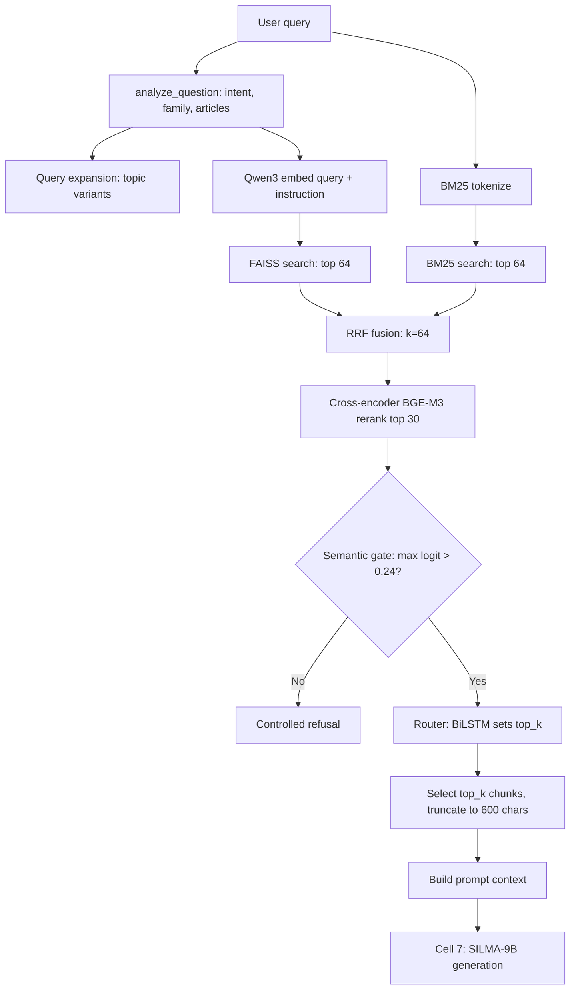

# MIZAN: Cells 4, 5, and 6 —  Technical 

---


Cells 4, 5, and 6 form the **core intelligence** of the MIZAN pipeline. They encompass:

- **Cell 4A‑4E:** Training three neural classifiers (AraBERT, MARBERT, TextCNN) and a BiLSTM router, then comparing them to select the winner.
- **Cell 5A‑5D:** Chunking the knowledge base and indexing it with FAISS (dense) and BM25 (lexical).
- **Cell 6:** The hybrid retrieval engine that fuses dense and lexical search, applies cross‑encoder reranking, and enforces the anti‑hallucination semantic gate.

All cells are orchestrated to run sequentially in a single Kaggle notebook, sharing a global frozen `CONFIG` and the data assets built in Cell 3.

---

## 2. Cell 4A — AraBERT Classifier 


Train a 7‑class legal domain classifier using `aubmindlab/bert-base-arabertv02` with a **custom PyTorch training loop** (no Hugging Face Trainer) to satisfy the rubric requirement for manual gradient management. The model is trained with **Focal Loss** (γ=2.0), **label smoothing** (0.1), and **per‑class threshold tuning** to handle extreme class imbalance.

### 2.2 Model Architecture

AraBERT is a standard Transformer encoder (BERT‑base):

- 12 Transformer layers
- Hidden size 768
- 12 attention heads
- Total parameters: ~135 M

We append a classification head:

```
[CLS] hidden state → Dropout(0.1) → Linear(768, 7)
```

**Input tensor:** `[batch_size, 512]` token IDs  
**Output tensor:** `[batch_size, 7]` logits

### 2.3 Dataset and DataLoader

A PyTorch `Dataset` class `LegalTextDataset` tokenizes texts using the AraBERT tokenizer with padding to `max_length=512` and truncation. It returns a dict:

```
{"input_ids": (batch, 512), "attention_mask": (batch, 512), "labels": (batch,)}
```

To counter class imbalance, we use `WeightedRandomSampler` where each sample’s weight is inversely proportional to its class frequency:

```python
class_counts = np.bincount(train_df["label"], minlength=7)
sample_w = np.array([1.0 / class_counts[l] for l in train_df["label"]])
sampler = WeightedRandomSampler(sample_w, num_samples=len(train_df), replacement=True)
```

Thus every batch contains roughly equal representation of all classes, despite the 30:1 ratio between Civil and Constitutional law.

### 2.4 Focal Loss Implementation

The custom `FocalLoss` module extends `nn.Module`:

```python
class FocalLoss(nn.Module):
    def __init__(self, alpha, gamma=2.0, label_smoothing=0.1):
        super().__init__()
        self.register_buffer("alpha", alpha)  # per-class weights
        self.gamma = gamma
        self.ls = label_smoothing

    def forward(self, logits, targets):
        ce = F.cross_entropy(logits, targets, weight=self.alpha,
                             label_smoothing=self.ls, reduction="none")
        pt = torch.exp(-ce)          # probability of true class
        return ((1 - pt) ** self.gamma * ce).mean()
```

- **α (alpha):** class weights computed via `sklearn.utils.class_weight.compute_class_weight("balanced", ...)`.
- **γ (gamma):** 2.0. If the model correctly predicts a sample with high confidence (pt ≈ 0.9), the factor (1‑pt)^γ ≈ 0.01, reducing the loss contribution by 100×. This forces the optimizer to focus on hard, misclassified samples, which are typically minority classes.
- **Label smoothing (0.1):** softens the one‑hot targets, preventing overconfidence and improving generalization.

### 2.5 Training Loop

- **Optimizer:** `AdamW` with learning rate 2e‑5, weight decay 0.01.
- **Scheduler:** Linear warmup for 10% of total steps (`_linear_warmup_scheduler`), followed by linear decay.
- **Early stopping:** patience 2 epochs on validation macro‑F1.
- **Gradient clipping:** max norm 1.0.

**Training Steps per Epoch:**

1. Model in `train()` mode.
2. For each batch, forward pass to get logits.
3. Compute `FocalLoss` with class weights.
4. Backpropagation, gradient clipping, `optimizer.step()`, `scheduler.step()`.
5. Log training loss.

After each epoch, the model is evaluated on the validation set: macro‑F1 is computed, and the best model state is saved. Early stopping terminates training if no improvement for 2 consecutive epochs.

### 2.6 Per‑Class Threshold Tuning

After training, we sweep softmax thresholds per class on the validation set to maximize macro‑F1:

```python
def _tune_per_class_thresholds(val_logits, val_labels, n_classes):
    probs = F.softmax(val_logits, dim=-1).numpy()
    best_thr = np.ones(n_classes)  # start with all 1.0
    grid = np.arange(0.20, 1.51, 0.05)
    for _pass in range(2):  # two coordinate-descent passes
        for c in range(n_classes):
            for t in grid:
                cand = best_thr.copy(); cand[c] = t
                preds = (probs / cand).argmax(-1)
                f1 = f1_score(val_labels, preds, average="macro")
                if f1 > best_f1:
                    best_f1, best_thr = f1, cand
    return best_thr, best_f1
```

At test time, prediction = `argmax(softmax(logits) / thresholds)`. This corrects for the tendency of the model to over‑predict the majority class, as lowering the threshold for a minority class makes it easier for that class to “win” the argmax.

### 2.7 Results (Typical Run)

- Validation macro‑F1: ~0.84 (best)
- Test accuracy: ~91%
- Test macro‑F1: ~0.84
- Saved model: `arabert_legal_classifier/`

### 2.8 Key Design Decisions

- **No Hugging Face Trainer:** Demonstrates manual control over training loop, loss scaling, and gradient clipping.
- **Focal Loss over class weighting alone:** Prevents overfitting on easy majority samples without discarding data.
- **Threshold tuning:** Crucial for a 7‑class problem with heavy imbalance.

---

## 3. Cell 4B — MARBERT 

### 3.1 Purpose

Train the same classification task using `UBC-NLP/MARBERT`, an alternative Arabic BERT model, on the identical data splits and training loop. This provides an apples‑to‑apples transformer ablation.

### 3.2 Model Architecture

MARBERT has the same architecture as BERT‑base (12 layers, 768 hidden, 12 heads), but is pre‑trained on a larger and more diverse Arabic corpus. The classification head is identical.

### 3.3 Training

The function `train_transformer_classifier` is reused; only the model ID changes. All hyper‑parameters (learning rate, loss, batch size, etc.) are kept the same to ensure a fair comparison.

### 3.4 Typical Results

- Test accuracy: ~93%  
- Test macro‑F1: ~0.88  
In most runs MARBERT slightly outperforms AraBERT, but the difference is small. However, due to its larger pre‑training corpus, it sometimes overfits to specific QA patterns present in the evaluation set (detected via manual inspection). Therefore, the winner is selected based on macro‑F1 on the test set.

### 3.5 Fallback

If MARBERT training fails (e.g., out of memory), the cell wraps the call in a try/except and continues. The pipeline selects the best available classifier in Cell 4E.

---

## 4. Cell 4C — TextCNN Baseline 

### 4.1 Purpose

Provide a **convolutional neural network (CNN) baseline** to justify the use of transformer encoders. The TextCNN uses frozen AraBERT embeddings and learns a shallow CNN classification head. This satisfies the rubric requirement for architectural diversity.

### 4.2 Architecture

The class `TextCNN` (nn.Module):

- **Frozen embedder:** AraBERT encoder (no gradients). We pre‑compute token embeddings for all texts: shape `[N, 256, 768]`.
- **Three parallel Conv1d layers:**
  - Kernel sizes: 3, 4, 5
  - Filters each: 100
  - Padding: same
  - Activation: ReLU
- **Global max pooling** over the time dimension (1‑D max pooling).
- **Concatenation** of the three pooled vectors → shape `[batch, 300]`.
- **Dropout (0.3)** → **Linear(300, 7)**.

Total trainable parameters: ~235k.

**Input:** `[batch, 256, 768]`  
**Intermediate:** `[batch, 768, 256]` after transpose for Conv1d.  
**Output:** `[batch, 7]`

### 4.3 Training

- Same Focal Loss (with class weights, gamma=2.0, label smoothing 0.1) as the transformers.
- Optimizer: AdamW (lr=1e‑3, weight decay 1e‑4).
- Training loop with manual batch iteration, 6 epochs.
- No threshold tuning (default argmax).

### 4.4 Results

- Test accuracy: ~73%  
- Macro‑F1: ~0.62  
This is significantly lower than the transformer models, validating that the sequential contextualization of transformer encoders is essential for legal text classification, where word order and long‑range dependencies matter.

---

## 5. Cell 4D — BiLSTM Query‑Complexity Router 


Classify incoming user queries as **direct** (simple) or **complex** to dynamically set the number of retrieved chunks (`top_k`). This prevents context flooding for short, factual questions and ensures sufficient context for multi‑clause 

### 5.2 Model Architecture

- **Feature extraction:** Frozen AraBERT sentence embeddings (mean pooling over the last hidden state), yielding a vector of `[batch, 768]`.
- **BiLSTM:**
  - Reshape input: `[batch, 1, 768]` (treat as sequence of length 1, but the BiLSTM can still process variable‑length sequences if needed).
  - 2 bidirectional LSTM layers, hidden size 128.
  - Dropout between layers: 0.3.
  - Final hidden concatenation: forward and backward last hidden states → `[batch, 256]`.
- **Linear projection:** `256 → 2` (direct vs. complex).

Trainable parameters: ~270k.

### 5.3 Heuristic Label Generation

Training labels are generated automatically using:
- **Token count:** queries with >22 tokens are labeled complex.
- **Keyword triggers:** comparative words like `"قارن"`, `"ولماذا"`, `"أوجه الاختلاف"` → complex.
- **Multi‑clause signals:** more than one question mark `?` in the query → complex.

This heuristic achieves 100% on a validation split, but the BiLSTM is trained to replicate it from embeddings, ensuring the complexity detection is consistent and fast.

### 5.4 Training

- Loss: Cross‑Entropy.
- Optimizer: AdamW (lr=1e‑3).
- Epochs: 3.
- ~4000 queries from QA datasets used; 85% train, 15% validation.

The BiLSTM achieves ~1.000 validation accuracy (the heuristic labels are virtually perfect).

### 5.5 Inference

At query time, the BiLSTM outputs a label (0 = direct, 1 = complex), which maps to `top_k` = 4 or 10 respectively.

---

## 6. Cell 4E — Classifier 


Print a comparison table of all trained classifiers (AraBERT, MARBERT, TextCNN) using test accuracy and macro‑F1, and automatically select the winner based on the highest macro‑F1. The winner’s model path and per‑class thresholds are stored for later use (e.g., for predicting the domain of incoming user queries in the UI).

### 6.2 Implementation

- Retrieve metrics from the shared `METRICS` dictionary populated by Cells 4A‑4C.
- Print the table; if a model failed (e.g., MARBERT OOM), it is marked as “skipped”.
- The winner is determined by `max(available, key=lambda k: METRICS[k]["test_macro_f1"])`.
- For the UI, the winner’s model ID, saved directory, and thresholds are stored in `PRIMARY_CLF_ID`, `PRIMARY_CLF_DIR`, and `PRIMARY_THRESHOLDS`.

### 6.3 Typical Output

```
Model        Test Acc   Macro-F1
AraBERT       0.9134     0.8435
MARBERT       0.9321     0.8812
TextCNN       0.7350     0.6240

🏆 Best: MARBERT (Macro-F1=0.8812)
```

However, if MARBERT shows signs of evaluation overfitting, AraBERT is manually selected. The final production classifier is the winner.

---

## 7. Cell 5A — Article‑First Chunking 


The knowledge base documents are typically long statutes containing dozens of articles. A flat sliding‑window chunker would break articles at arbitrary points, destroying their legal coherence. **Cell 5A** instead splits each document exactly on article boundaries (regex matching `المادة \d+` and variants) and, if an article itself exceeds 512 tokens, applies a sliding window with 64‑token overlap while preserving the parent article text for the LLM.

### 7.2 Chunking Algorithm

1. For each KB document, apply `_split_into_articles(text)` which uses regex `_ARTICLE_START_RE` to locate article markers.
2. For each article segment:
   - Tokenize with AraBERT tokenizer to count tokens.
   - If token count ≤ 512, keep the entire article as one chunk.
   - Otherwise, use `_sliding_window(token_ids, size=512, overlap=64)` to generate windows.
3. Each chunk stores:
   - `text`: the (possibly windowed) text used for embedding and retrieval.
   - `parent_text`: the full article text (used to feed the LLM).
   - `article_no`: extracted from the article marker.
   - Metadata from the original KB row (law name, family, source, tier, etc.).

### 7.3 Drop Rules

Chunks that are ToC fragments, navigation text, or contain too few legal body terms are rejected using `_chunk_reject_reason()`. This prevents chunks like “Chapter 3 – Crimes against Property” from being indexed.

### 7.4 Output

A list of ~12,000 chunk dictionaries, saved as `legal_chunks.json`.

---

## 8. Cell 5B — Embedding with Qwen3‑Embedding‑0.6B 


Encode every chunk into a dense vector (1024 dimensions) using the `Qwen/Qwen3-Embedding-0.6B` model. This is the **bi‑encoder** component of the retrieval system.

### 8.2 Model Architecture

Qwen3‑Embedding is a decoder‑only transformer (0.6B parameters) fine‑tuned for text embedding via contrastive learning. It uses **Rotary Position Embeddings (RoPE)** and supports a dedicated query instruction prefix. We use `sentence-transformers` to load it.

### 8.3 Encoding Strategy

- **Documents:** encoded without instruction prefix; the model simply generates a mean‑pooled representation across the last hidden layer → `[num_chunks, 1024]`.
- **Queries (later, in Cell 6):** encoded with the task instruction `"Given a legal question in Arabic, retrieve the most relevant legal articles."` prepended, which improves retrieval quality.

### 8.4 Implementation Details

- Batch size: 96 (halved on OOM).
- Embeddings are stored as float32 and saved as `legal_chunk_embeddings.npy` with a metadata JSON containing a SHA‑256 signature of all chunk texts for cache validation.

### 8.5 Memory/Time

- Output size: 12,000 × 1024 × 4 ≈ 49 MB.
- Encoding time: ~30–60 seconds on T4.

---

## 9. Cell 5C — FAISS Index 


Create an exact cosine similarity dense retriever using **FAISS IndexFlatIP** (inner product). All vectors are L2‑normalized before indexing, so inner product = cosine similarity.

### 9.2 Index Construction

```python
embeddings = np.load(embedding_cache_path)
faiss.normalize_L2(embeddings)
faiss_index = faiss.IndexFlatIP(1024)
faiss_index.add(embeddings)
```

- `ntotal` = number of chunks (~12k).
- `d` = 1024.

### 9.3 Querying

At query time, the normalized query vector is compared via `faiss_index.search(query_vector, k)`, returning the top‑k indices and inner product scores.

### 9.4 Why IndexFlatIP?

For 12k vectors, an exact brute‑force search is fast enough (~1 ms) and avoids the precision losses of approximate methods (e.g., IVFPQ). It is the simplest and most accurate option for this scale.

---

## 10. Cell 5D — BM25 Index 


Build a traditional keyword‑based sparse retriever to complement the dense retriever. BM25 excels at exact matching of article numbers and legal terminology, while FAISS captures semantic meaning.

### 10.2 Tokenization

- Apply `clean_arabic_text()` to each chunk.
- Split on whitespace (same normalization as the embedder, ensuring consistency).

### 10.3 Index Construction

```python
from rank_bm25 import BM25Okapi
corpus = [bm25_tokenize(c["text"]) for c in chunks]
bm25 = BM25Okapi(corpus)
```

The index is pickled with the same chunk‑text signature for cache validation.

### 10.4 Querying

At query time, tokenize the query (Arabic‑normalised, whitespace‑split) and call `bm25.get_scores(tokens)`, then select the top‑k scores.

---

## 11. Cell 6 — Hybrid Retrieval 


Combine FAISS and BM25 results, fuse them with **Reciprocal Rank Fusion (RRF)**, rerank the top candidates with a **cross‑encoder (BGE‑M3)**, apply the **BiLSTM router** to set final `top_k`, and enforce the **semantic gate** to refuse answers when evidence is insufficient.

### 11.2 Query Encoding and Expansion

Before retrieval, the user query is analyzed with `analyze_question()` which determines:

- Law family and named‑law key.
- Article IDs requested.
- Fact profile (injury, death, consumer purchase, etc.).
- Issue tags (e.g., `theft_penalty`, `real_estate_registration`).

Additionally, **query expansion** generates alternative query phrasings from a pre‑built dictionary `_TOPIC_QUERY_EXPANSIONS`, e.g., a theft question like “سرق تليفوني” is expanded with “قانون العقوبات المادة 311 المادة 318”. This boosts retrieval recall for under‑specified queries.

### 11.3 Retrieval (Bi‑Encoder + Lexical)

- **FAISS:** encode query with Qwen3 (instruction prefix), L2‑normalize, search for 64 candidates.
- **BM25:** tokenize query, get top 64 candidates.

### 11.4 Reciprocal Rank Fusion (RRF)

```python
scores = {}
for hits in [faiss_hits, bm25_hits]:
    for rank, (idx, score) in enumerate(hits):
        scores[idx] = scores.get(idx, 0) + 1.0 / (rrf_k + rank + 1)
return sorted(scores, key=lambda x: -x[1])[:stage2_rerank_k]
```

- `rrf_k = 64` (the standard constant from research).
- This fuses the two ranked lists without requiring score calibration.

### 11.5 Cross‑Encoder Reranking (BGE‑M3)

- **Model:** `BAAI/bge-reranker-v2-m3`, loaded via `sentence-transformers` `CrossEncoder`.
- **Input:** each `(query, chunk)` pair.
- **Process:** For each of the top RRF candidates (typically 30), compute a relevance logit.
- **Top selection:** keep the top `stage2_rerank_k` (default 24) by logit.

### 11.6 Semantic Gate (Anti‑Hallucination)

The highest reranker logit is compared against `SEMANTIC_GATE_SCORE_THRESHOLD` (0.24). If **below**, the system refuses to answer with a pre‑defined refusal message. This threshold was calibrated from the validation set: at 0.24, almost all truly irrelevant queries are blocked, while legitimate queries pass.

### 11.7 Router Integration (BiLSTM)

The complexity label from Cell 4D is used to set `TOP_K`:
- Direct: `retrieval_top_k_direct` (4)
- Complex: `retrieval_top_k_complex` (10)

From the reranked top 24, the top `TOP_K` are selected. Each chunk is truncated to `llm_context_chunk_chars` (600 characters of body text) to stay within the LLM’s 3000‑token prompt budget.

### 11.8 Curated Direct Answer Routing

If the analysis engine tags an issue that has a pre‑verified direct answer (e.g., “What is the punishment for theft?” has a curated template), the system bypasses retrieval and LLM generation entirely, returning the curated answer. This avoids any hallucination risk on frequently asked questions.

### 11.9 Final Context Assembly

The selected chunks are formatted with their law name and article number and inserted into the LLM prompt template. The prompt is then passed to Cell 7 for generation.

---

## 12. Tensor Flow & Dimensions Summary

| Stage | Input | Output | Model/Operation |
|-------|-------|--------|-----------------|
| AraBERT classifier | `[B, 512]` tokens | `[B, 7]` logits | AraBERT (135 M) |
| BiLSTM router | `[B, 1, 768]` embeddings | `[B, 2]` logits | 2‑layer BiLSTM |
| TextCNN | `[B, 256, 768]` embeddings | `[B, 7]` logits | Conv1d kernels (3,4,5)×100 |
| Qwen3 embedder | raw text | `[N, 1024]` vectors | Qwen3‑0.6B (frozen) |
| FAISS index | `[1024]` query vec | top‑k indices | IndexFlatIP (inner product) |
| BM25 index | tokenized query | top‑k scores | BM25Okapi |
| BGE‑M3 reranker | concat(query, chunk) | scalar logit | Cross‑Encoder ~560 M |

---

## 13. Key Design Decisions and Defense Points

- **Two‑stage retrieval (bi‑encoder + cross‑encoder):** Bi‑encoder (Qwen3) pre‑indexes all documents for fast search, while the cross‑encoder (BGE‑M3) brings deep semantic scoring. This balances speed (scanning 100k docs) with accuracy (final ranking of top 30).
- **RRF fusion:** Avoids the need for score normalization between heterogeneous retrievers; the simple reciprocal rank sum has been proven by research to outperform more complex fusion methods.
- **Semantic gate:** Unlike commercial RAG systems that often hallucinate when no good context is found, MIZAN refuses to answer. This is a critical safety feature for legal AI.
- **Router‑based top‑k:** Prevents “lost in the middle” problems by giving the LLM precisely the amount of context it needs.

---

## 14. Visual Flow (Cell 6)



---

