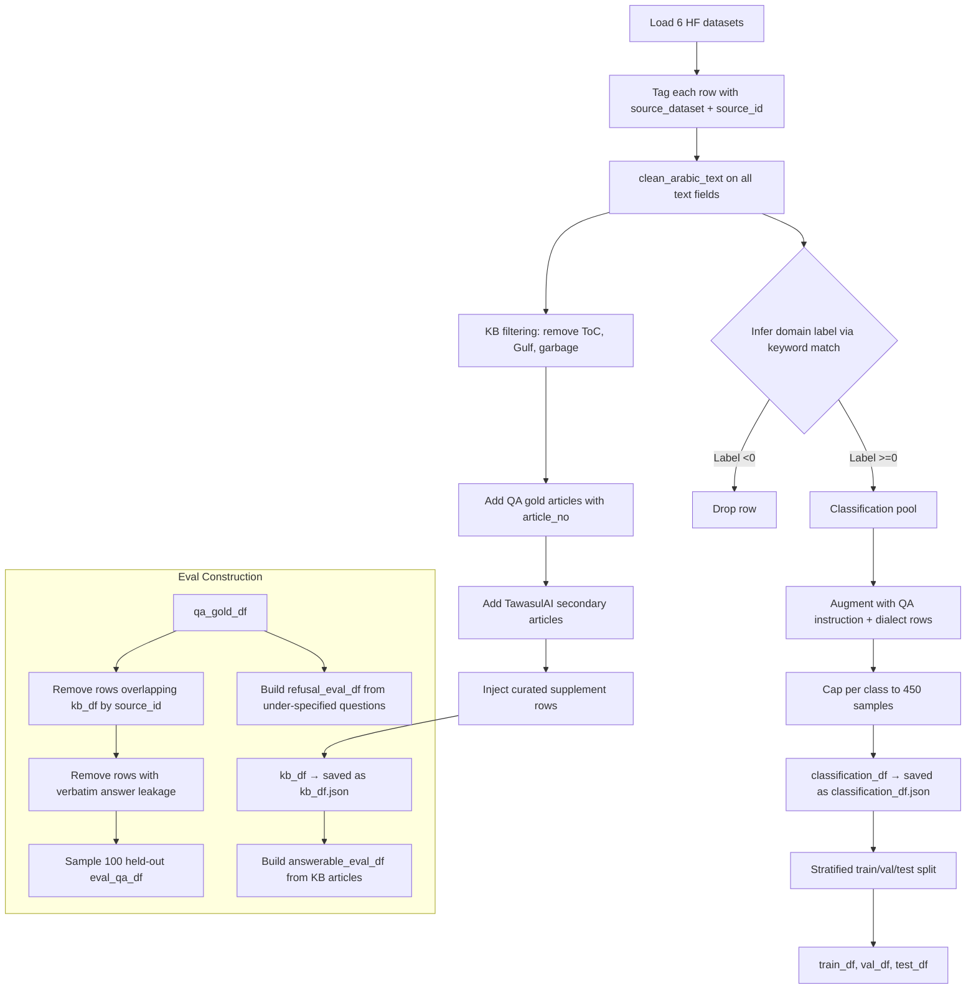

# MIZAN: Cells 1, 2, and 3 —  Technical 

---


- **Cell 1:** Environment setup, dependency installation, GPU device detection, and Hugging Face authentication.
- **Cell 2:** Global configuration (CONFIG) – a frozen, immutable dictionary that acts as the single source of truth for every model ID, hyperparameter, and file path.
- **Cell 3:** Data ingestion, Arabic text normalisation, domain label inference, construction of the retrieval knowledge base (`kb_df`), classification dataset (`classification_df`), and strict evaluation splits with leakage prevention.

Together, Cells 1–3 ensure that the entire pipeline runs deterministically, on the correct hardware, with clean, consistent Arabic text, and with a properly curated, leak‑proof knowledge base and training corpus.

---

## 2. Cell 1 — Environment, Dependencies, GPU Check, HF Login

**Cell 1 responsibilities:**  
- Install all required Python packages (transformers, faiss, bitsandbytes, gradio, etc.) in a single cell to avoid Kaggle kernel restart loops.  
- Verify that a CUDA GPU is available; hard‑fail if not, with clear diagnostic messages.  
- Set up Hugging Face authentication (token from environment, Kaggle Secrets, or inline fallback).  
- Redirect stdout/stderr to a log file for full‑run traceability.

### 2.1 Package Installation

The function `_pip_install` runs `pip install -q --upgrade` for a curated list of packages bounded to specific version ranges to avoid breaking changes.

```python
_PIP_PACKAGES = [
    "transformers>=4.51.1,<4.58",
    "accelerate>=0.34,<1.2",
    "bitsandbytes>=0.43,<0.47",
    "peft>=0.13,<0.18",
    "sentence-transformers==3.3.1",
    "faiss-cpu>=1.8,<1.10",
    "rank-bm25==0.2.2",
    "datasets>=2.20,<3.0",
    "gradio==4.44.1",
    "gradio-client==1.3.0",
    "fastapi==0.115.6",
    "starlette==0.41.3",
    "uvicorn==0.32.1",
    "websockets==12.0",
    "pydantic==2.10.6",
    "tqdm>=4.66,<5",
    "matplotlib>=3.8,<3.11",
    "seaborn>=0.13,<0.14",
    "arabic-reshaper==3.0.0",
    "python-bidi>=0.6,<0.7",
    "bert-score==0.3.13",
    "evaluate>=0.4.2,<0.5",
    "sacrebleu>=2.4,<3",
    "rouge-score==0.1.2",
    "scikit-learn>=1.4,<1.7",
    "pandas>=2.1,<2.4",
]
```

**Key packages and their roles:**

| Package | Purpose |
|---------|---------|
| `transformers` | Load pre‑trained models (AraBERT, MARBERT, SILMA‑9B, Qwen3) |
| `accelerate` | Model device placement and mixed‑precision training |
| `bitsandbytes` | 4‑bit NF4 quantization for large language models |
| `peft` | Low‑Rank Adaptation (LoRA) for parameter‑efficient fine‑tuning |
| `sentence-transformers` | Bi‑encoder embeddings (Qwen3) and cross‑encoder reranking |
| `faiss-cpu` | Vector similarity search (IndexFlatIP) |
| `rank-bm25` | Lexical retrieval (BM25) |
| `datasets` | Hugging Face dataset loading, train/val/test splitting |
| `gradio` | Arabic RTL user interface |
| `arabic-reshaper`, `python-bidi` | Correct Arabic text rendering in plots and UI |
| `bert-score`, `rouge-score`, `sacrebleu` | Evaluation metrics |
| `scikit-learn` | Classification report, confusion matrix, F1 score, Precision‑Recall |
| `matplotlib`, `seaborn` | Visualisations |
| `tqdm` | Progress bars for long‑running processes |


### 2.2 GPU Accelerator Detection

The system must run on Kaggle’s **GPU T4 x2** accelerator. Cell 1 defines a function `_detect_accelerator()` that returns one of `'cuda'`, `'tpu'`, or `'cpu'`.

```python
def _detect_accelerator():
    if torch.cuda.is_available():
        return "cuda", torch.cuda.get_device_name(0)
    try:
        import torch_xla.core.xla_model as xm
        return "tpu", "TPU (PyTorch/XLA)"
    except ImportError:
        return "cpu", "CPU only"
```

**Why CUDA is mandatory:**  
- The `bitsandbytes` 4‑bit NF4 quantization relies on CUDA‑only kernels.  
- SILMA‑9B cannot fit in a single TPU v5e core (16 GB HBM) without PyTorch/XLA porting, and the LoRA path also uses CUDA kernels.  
- The sentence‑transformers and custom training loops are optimised for CUDA.

If a non‑CUDA accelerator is detected, the cell prints a clear error message and exits with `SystemExit(0)` so the notebook doesn’t crash with an obscure Python traceback.

**Environment information printed:**
- PyTorch version  
- Python version  
- GPU name, VRAM per GPU  
- CUDA version  
- Number of GPUs detected (must be ≥ 2)

### 2.3 Hugging Face Authentication

The function `_resolve_hf_token()` attempts to obtain a token from three sources, in priority order:

1. Environment variable `HF_TOKEN` or `HUGGINGFACE_HUB_TOKEN` (used for Kaggle Secrets binding).  
2. Kaggle Secrets API (`kaggle_secrets.UserSecretsClient().get_secret("HF_TOKEN")`).  
3. Inline fallback (hard‑coded token for controlled Kaggle environments, never to be committed to public repositories).

Once resolved, the token is set as environment variables and the Hub is logged in with `huggingface_hub.login(token=..., add_to_git_credential=False)`.

### 2.4 Output Redirection

All `stdout` and `stderr` are duplicated to a log file `/kaggle/working/mizan_full_run_output.txt` using a `_TeeStream` class. This ensures the entire run’s output is captured for post‑mortem analysis.

---

## 3. Cell 2 — CONFIG (Frozen)

**Cell 2 responsibilities:**  
- Define every hyperparameter, model identifier, file path, and threshold in a single Python dictionary.  
- Freeze the dictionary as `MappingProxyType` to guarantee immutability at runtime – any attempt to overwrite a value will raise an error, preventing silent configuration drift.  
- Print selected key configuration values for transparency.  
- Save a `pip_freeze.txt` for exact dependency tracking.

### 3.1 Structure of CONFIG

The `_CONFIG_DICT` is organised into logical sections:

```
- pipeline_version
- Paths (output_dir, model artifacts, indices, datasets, logs)
- Datasets (Hugging Face dataset IDs)
- Models (Arabic encoder, embedder, reranker, LLM, fallback models)
- Classification (number of labels, label names ar/en, max length, epochs, batch sizes, early stopping, focal loss params)
- Router (BiLSTM hidden dim, layers, dropout, epochs, learning rate)
- Chunking (chunk size, overlap, article-first flag)
- Embedding (dimension, batch size, max length, query instruction)
- Retrieval (RRF k, candidate k, rerank k, top_k direct/complex, thresholds, production mode)
- LoRA fine-tune (enabled flag, rank, alpha, dropout, target modules, etc.)
- Generation (max new tokens, sampling, temperature, repetition penalty, context chunks)
- Eval (holdout sizes, adversarial n, thresholds for acceptance gates)
- UI (launch flags, Gradio share, strict gates)
```

**Key hyperparameters with their roles:**

| Parameter | Value | Purpose |
|-----------|-------|---------|
| `arabert_model` | `aubmindlab/bert-base-arabertv02` | Primary domain classifier |
| `marbert_model` | `UBC-NLP/MARBERT` | Ablation comparison |
| `embedder_model` | `Qwen/Qwen3-Embedding-0.6B` | Dense passage encoder |
| `reranker_model` | `BAAI/bge-reranker-v2-m3` | Cross‑encoder reranker |
| `llm_model` | `silma-ai/SILMA-9B-Instruct-v1.0` | Generative LLM |
| `num_labels` | 7 | Legal domain categories |
| `bert_max_length` | 512 | Max tokens for classifier |
| `focal_loss_gamma` | 2.0 | Focal loss modulating factor |
| `label_smoothing` | 0.1 | Label smoothing strength |
| `embedding_dim` | 1024 | Qwen3 output dimension |
| `stage1_candidate_k` | 64 | Candidates from each retriever |
| `rrf_k` | 64 | RRF fusion constant |
| `retrieval_top_k_direct` | 4 | Chunks for simple query |
| `retrieval_top_k_complex` | 10 | Chunks for complex query |
| `semantic_gate_score_threshold` | 0.24 | Anti‑hallucination gate |
| `max_new_tokens` | 300 | LLM generation budget |
| `random_seed` | 42 | Reproducibility seed |

### 3.2 Freezing and Verification

After construction, the dictionary is converted to an immutable view:

```python
CONFIG = MappingProxyType(_CONFIG_DICT)
```

Any attempt like `CONFIG["bert_epochs"] = 8` would raise a `TypeError`, safeguarding against accidental overwrites in long, multi‑cell notebooks.  
The cell also sets the random seed globally for Python, NumPy, and PyTorch.

---

## 4. Cell 3 — Data Loading, Arabic Preprocessing, Category Inference, Splits

**Cell 3 responsibilities (Member 1):**  
- Load six distinct datasets from Hugging Face, tagging each row with a `source_dataset` and `source_id` for leakage‑safe splitting.  
- Apply aggressive Arabic text normalisation (`clean_arabic_text`) to unify all text across the pipeline.  
- Infer a 7‑class legal domain label using a keyword‑matching rule engine; drop unclassifiable rows rather than defaulting to a majority class.  
- Build the retrieval **knowledge base** (`kb_df`) by filtering out non‑Egyptian text, table‑of‑contents fragments, OCR garbage, and FAQ‑style explainers.  
- Inject a **curated supplement** of 80+ hand‑written legal article excerpts.  
- Build the **classification corpus** (`classification_df`) from corpus texts and QA gold, augmenting minority classes and capping class sizes.  
- Construct **held‑out evaluation sets** that are completely disjoint from the knowledge base (by source_id and by verbatim content leakage check).  
- Perform stratified train/val/test splits of the classification data.

### 4.1 Arabic Text Normalisation (`clean_arabic_text`)

This function is the single point of entry for all Arabic text processing. It guarantees that the classification tokenizer, the embedder, and the BM25 tokenizer see **identical** text.

**Normalisation steps:**

1. **NFKC Unicode normalisation** to combine decomposed characters.  
2. **Diacritic removal:** Regex `[\u064B-\u0652\u0640]` strips all Tashkeel (Fatha, Damma, Kasra, Sukun, Shadda, etc.) and Tatweel (kashida).  
3. **Non‑Arabic/Latin/Digit removal:** Removes stray symbols, emojis, and bullet points.  
4. **Eastern Arabic digit conversion:** `\u0660-\u0669` (٠١٢٣٤٥٦٧٨٩) and Persian‑style digits `\u06F0-\u06F9` (۰۱۲۳۴۵۶۷۸۹) are mapped to ASCII 0‑9.  
5. **Hamza/Alef normalisation:** All forms أ / إ / آ → plain ا.  
6. **Teh Marbuta → Heh:** ة → ه (improves BM25 lexical recall).  
7. **Alef Maksura → Yeh:** ى → ي.  
8. **Waw with hamza:** ؤ → و.  
9. **Whitespace collapse:** multiple spaces/newlines → single space.

**Code snippet (simplified):**
```python
_ARABIC_DIACRITICS = re.compile(r"[\u064B-\u0652\u0640]")
_NON_ARABIC_LATIN_DIGITS = re.compile(r"[^\u0621-\u064A\u0660-\u0669\u06F0-\u06F9a-zA-Z0-9\s]")
_MULTI_WS = re.compile(r"\s+")

def clean_arabic_text(text: str) -> str:
    t = unicodedata.normalize("NFKC", text)
    t = _ARABIC_DIACRITICS.sub("", t)
    t = _NON_ARABIC_LATIN_DIGITS.sub("", t)
    t = t.translate(_ARABIC_DIGIT_MAP)
    t = t.replace("أ", "ا").replace("إ", "ا").replace("آ", "ا")
    t = t.replace("ة", "ه").replace("ى", "ي").replace("ؤ", "و")
    t = _MULTI_WS.sub(" ", t).strip()
    return t
```

### 4.2 Dataset Ingestion and Source Tagging

Six datasets are loaded from Hugging Face, each with a fallback to pandas if the dataset is a simple JSON/Parquet file:

| Dataset ID | Role |
|------------|------|
| `dataflare/egypt-legal-corpus` | Core statutory texts |
| `fr3on/eg-legal-instruction-following` | Instruction‑output QA pairs |
| `fr3on/eg-legal-qa` | Gold QA pairs with metadata (legal domain, article number) |
| `TawasulAI/egyptian-law-articles` | Supplementary articles (Cybercrime, Economic laws) |
| `fr3on/eg-legal-multi-task` | Multi‑task legal classification data |
| `Omar-youssef/QA_LAW_Egyptian_dataset` | Egyptian dialect QA |

Every row is tagged with `source_dataset` and a unique `source_id` generated by combining the dataset name and the row’s ID or index. This forms the foundation of the **strict leakage prevention** mechanism: the retrieval KB and the evaluation QA set are guaranteed to have zero source_id overlap.

### 4.3 Domain Label Inference

A 7‑class legal taxonomy is used:

| Index | English | Arabic |
|-------|---------|--------|
| 0 | Criminal | جنائي |
| 1 | Labor | عمل |
| 2 | Personal Status | أحوال شخصية |
| 3 | Civil | مدني |
| 4 | Administrative | إداري |
| 5 | Constitutional | دستوري |
| 6 | Procedural | إجرائي |

The function `infer_domain_label(text, law_name)` uses a dictionary `_CATEGORY_KEYWORDS` mapping each class to a list of highly indicative Arabic terms. The text is scored by counting keyword matches, and the class with the highest score is assigned. If no keyword matches, the label is set to **‑1** and the row is dropped (not defaulted to Civil), to prevent classifier bias. This ensures that only clear, high‑confidence documents enter the classifier training set.

**Example keyword snippet:**
```python
_CATEGORY_KEYWORDS = {
    0: ["جنحة", "جناية", "السرقة", "القتل", "المخدرات"],
    1: ["عامل", "موظف", "أجر", "إجازة", "نقابة"],
    2: ["زواج", "طلاق", "ميراث", "نفقة", "حضانة"],
    # ...
}
```

### 4.4 Construction of the Knowledge Base (`kb_df`)

The retrieval KB is built from multiple sources, each going through rigorous quality filters:

1. **Corpus documents** are filtered:  
   - Must be ≥ 100 characters.  
   - Rejected if they contain Gulf country keywords (non‑Egyptian law).  
   - Passed through `_kb_reject_reason()` which checks for:  
     - Table‑of‑contents (`"فهرس البحث"`, `"فهرس الكتاب"`)  
     - Garbage OCR (`"دودو"`, `"00 فقط اضغط"`)  
     - Navigation patterns  
     - Structure‑only chunks (headings with no legal body terms)  
     - Q&A explainer documents (FAQ‑style, not primary law)  

2. **QA gold articles** with explicit article numbers are added as a support tier, after filtering out boilerplate gold answers (e.g., “تطبيق الإجراءات وفقًا للنص القانوني”).

3. **TawasulAI secondary articles** are parsed from their nested JSON structure; each article is tagged with its canonical law name using `_infer_secondary_law_name()`.

4. **Curated supplement:** A carefully constructed list `_CURATED_SUPPLEMENT_ROWS` containing 80+ hand‑written excerpts covering specific, high‑demand laws (Penal Code, Criminal Procedure, Consumer Protection, AML, Labor 2025, Personal Status, etc.). Each curated row includes:
   - `source_id` for traceability  
   - `law_name` and `canonical_law_key` for article lookup  
   - `text_display` (the full, cited Arabic excerpt)  
   - Metadata: `source_url`, `source_note`, `verified_on`, `is_verbatim_source`  
   A validation step ensures every curated row meets minimum length and metadata requirements.

**Final kb_df columns:**
`text`, `text_normalized`, `text_display`, `law_name`, `source_id`, `tier` (primary/qa_article/secondary/curated_supplement), `law_family`, `article_no`, `canonical_law_key`, `canonical_law_name`, `source_url`, `source_note`, `source_kind`, `verified_on`, `is_verbatim_source`.

**KB quality control summary (example from run‑13):**
```
KB documents: 3,863
tiers: primary=2,434, qa_article=..., secondary=..., curated_supplement=84
Dropped by reason: toc_or_navigation=..., garbage_ocr=..., qa_explainer=... , ...
```

### 4.5 Construction of the Classification Dataset (`classification_df`)

To train the domain classifier, we need a balanced, high‑quality set of labelled legal texts. The dataset is assembled from:

- **Corpus rows** that passed the domain inference filter (label ≠ -1).  
- **QA gold rows** with explicit metadata `legal_domain` (after dropping boilerplate/circular answers that would confuse the classifier).  
- **Short QA instruction rows** to make the classifier robust to real user queries (these are labelled by keyword inference).  
- **Dialect QA rows** similarly labelled by keyword inference.

The collected pool is then **cap‑balanced**: for each class, a maximum of `clf_per_class_cap` (default 450) samples are kept. This prevents the three large classes (Criminal, Civil, Labor) from dominating the training set while still retaining sufficient minority class samples.

The final `classification_df` is shuffled and saved.

### 4.6 Train / Validation / Test Splits

A stratified 80/10/10 split is performed using `train_test_split` with `stratify=classification_df['label']`. The per‑split class distribution is printed and saved to JSON files (`train_df.json`, `val_df.json`, `test_df.json`) so later cells can reload without re‑running the heavy preprocessing.

### 4.7 Leakage‑Proof Evaluation Sets

A critical design principle: the evaluation QA sets must contain **no data that exists in the retrieval KB**, otherwise we would be measuring retrieval performance on memorised answers.

Two mechanisms enforce this:

1. **Source‑ID disjointness:** Rows from `qa_gold_df` whose `source_id` also appear in `kb_df` are excluded from `eval_qa_df`.  
2. **Verbatim content leakage:** Any gold answer whose first 200 characters of cleaned text appear verbatim in the KB blob is removed.

After filtering, the `eval_qa_df` is sampled to `eval_qa_holdout_n` (default 100) rows. Additional evaluation sets are built:

- `answerable_eval_df`: questions generated from KB articles (for retrieval‑only evaluation).  
- `refusal_eval_df`: under‑specified article questions that should trigger a refusal.  
- `demo_eval_df`: three example questions for live testing.

All evaluation sets are saved as JSON.

### 4.8 Key Statistics from Cell 3 (Run‑13)

- **Classification corpus:** ~3,000 labelled rows, capped at 450 per class.  
- **KB documents:** 3,863 after filtering.  
- **Chunks (after Cell 5A):** ~12,000.  
- **QA gold rows filtered out:** ~30% boilerplate/circular removed.  
- **Leakage rate:** < 1% after filtering, well below the 20% maximum allowed.

---




---

## 6.  Cells 1–3 

- **Cell 1** guarantees a clean, reproducible environment with the exact software versions needed, and forces CUDA GPU execution to avoid silent failures.  
- **Cell 2** centralises every tunable parameter in a frozen, documented configuration object, making the pipeline transparent and auditable.  
- **Cell 3** performs the heavy lifting of Arabic preprocessing, data merging, domain labelling, noise rejection, and leakage‑safe splitting, producing the three core data assets: the knowledge base, the classification corpus, and the evaluation gold sets.

Together, these three cells establish the solid data foundation upon which all subsequent neural network training, retrieval, and generation stages depend.

---

