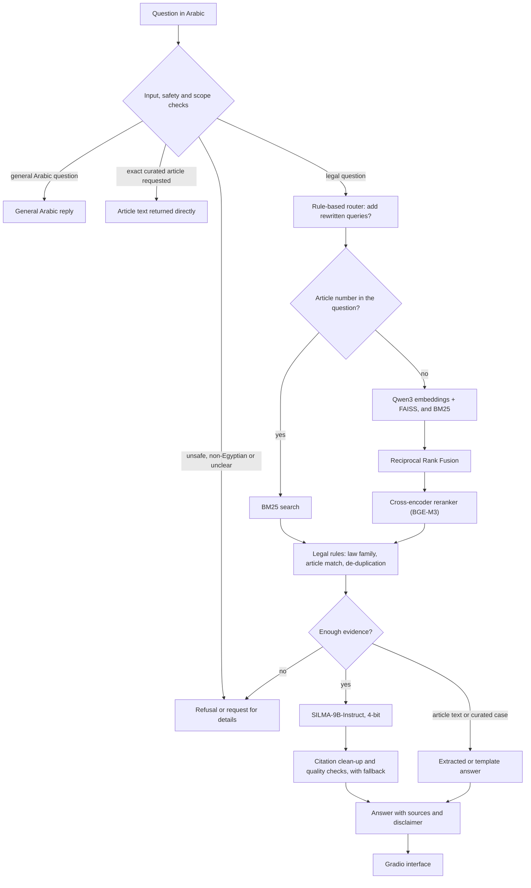

# MIZAN: Arabic legal assistant for Egyptian law

MIZAN is a retrieval-augmented question-answering system that answers Egyptian legal questions in Arabic. It is a team project, written as one Kaggle notebook and exported as [`mizan.py`](mizan.py).

Its answers are not legal advice.

## Pipeline

The diagram follows the answer path in `mizan.py`.



## Features

- Arabic text normalisation and a knowledge base built from public Egyptian law datasets plus hand-written article excerpts.
- Article-first chunking.
- Hybrid retrieval: dense search (`Qwen/Qwen3-Embedding-0.6B`, FAISS inner-product index) and BM25, combined with Reciprocal Rank Fusion.
- Reranking with `BAAI/bge-reranker-v2-m3`, with `jinaai/jina-reranker-v2-base-multilingual` as a fallback.
- Evidence gates that refuse to answer when the retrieved sources are weak or do not match.
- Answers generated by `silma-ai/SILMA-9B-Instruct-v1.0` in 4-bit, with the 2B SILMA Kashif model as a fallback.
- Experiments with 7-class legal domain classifiers (AraBERT, MARBERT, TextCNN) and a BiLSTM query router.
- Evaluation, error analysis and adversarial test cells, and a right-to-left Gradio interface.

## How it works

| Cells | Stage |
|-------|-------|
| 1, 2 | Install packages, check GPUs, log in to Hugging Face, set the configuration |
| 3 | Load and clean the data, infer legal categories, split |
| 5A to 5D | Chunk articles, embed them, build the FAISS and BM25 indexes |
| 4A to 4E | Train and compare the classifiers and the router |
| 6, 6B | Retrieval, reranking, filters, confidence calibration, evaluation references |
| 7, 7B | Load the language model and generate grounded answers; optional LoRA training |
| 8, 9 | Evaluation and error analysis |
| 10 to 11B | Interface definition, regression checks, smoke test and adversarial tests |

Two points differ from what the cell titles suggest:

- The BiLSTM router is trained, but answering uses a rule-based check (length, multiple questions, comparison words). When answering, its result only decides whether a long, complex question is also rewritten into extra search queries. The number of retrieved chunks is set separately.
- The domain classifiers are trained and compared. We found no call to them in the retrieval or answer code.

LoRA training is turned off in the configuration (`lora_enable: False`).

## Run on Kaggle

The code expects two NVIDIA T4 GPUs and stops if it finds fewer. It cannot run on a normal laptop.

1. Create a Kaggle notebook. Set the accelerator to **GPU T4 x2** and turn **Internet** on.
2. Add a Kaggle secret named `HF_TOKEN` with your own Hugging Face token, and accept the terms of any gated model on Hugging Face.
3. Copy the code from `mizan.py` into the notebook. Cells are marked with `# %%`. Keep the file order.
4. Run all cells. Cell 1 installs the packages, so no separate install step is needed.
5. After the tests, the last cells start the Gradio interface. `gradio_share` is on, so Gradio creates a public link; set it to `False` in the configuration to avoid that.

[`requirements.txt`](requirements.txt) lists the same package ranges for reference. Outputs are written to `/kaggle/working`.

### Data

Downloaded at run time from Hugging Face:

- `dataflare/egypt-legal-corpus`
- `fr3on/eg-legal-instruction-following`
- `fr3on/eg-legal-qa`
- `fr3on/eg-legal-multi-task`
- `TawasulAI/egyptian-law-articles`
- `Omar-youssef/QA_LAW_Egyptian_dataset`

Each dataset and model has its own license and terms.

## Results

**Reported by the team, not reproduced here.** The repository has no output files or logs for these numbers. They come from section 9 of the [team notes](docs/team-notes.md).

| Classifier | Test accuracy | Macro-F1 |
|------------|---------------|----------|
| AraBERT | 0.732 | 0.713 |
| MARBERT | 0.746 | 0.733 |
| TextCNN | 0.735 | 0.724 |

| Retrieval mode | Hit@1 | Hit@5 | MRR@10 |
|----------------|-------|-------|--------|
| BM25 | 0.280 | 0.427 | 0.343 |
| BM25 + FAISS (RRF) | 0.360 | 0.600 | 0.464 |
| Hybrid + BGE reranker | 0.387 | 0.653 | 0.493 |

The same notes report 167 of 180 adversarial questions refused (92.7%). Another section of the notes gives different classifier figures, so treat all of these with caution.

## What was checked

- This README was written by reading the code. The notebook, the tests and the interface were **not run**, so there is no screenshot.
- Accuracy, retrieval and refusal figures are **not verified**.

## Limitations

- Needs Kaggle GPUs and downloads several large models.
- The whole system is one file of more than 9,800 lines, with no separate test suite.
- Answering relies on many hand-written rules, curated excerpts and template answers for particular question types. Results on questions like those used during development may not carry over to new ones.
- The knowledge base is limited and may be incomplete or out of date. Check every answer against the official legal text.

## Project structure

```text
mizan.py            the notebook, exported as one script
requirements.txt    package ranges used by the notebook
docs/team-notes.md  the team's original technical notes
Ahmed Abo Bakr/     team member list, notes and diagrams
Ahmed Abd aelnaser/ notes and diagrams
Ahmed Mohamed/      notes and diagrams
Ahmed Sabry/        notes and diagrams
Ali/                notes and diagrams
ziad/               notes and diagrams
ANN Ahmed Abo Bakr.pdf   one-page architecture diagram
```

## Team

Team project. Roles as assigned in [`members.md`](Ahmed%20Abo%20Bakr/members.md):

| Member | Assigned part |
|--------|---------------|
| Ahmed Abobakr Hanafi | Reranking, hallucination gate and language model; evaluation and interface (cells 6 to 11B) |
| Ali Ez Alyan | Article-first chunking, dense embeddings, FAISS index and BM25 fusion (cells 5A to 5D) |
| Ahmed Sabry Hamza | Legal domain classification (cells 4A, 4B, 4C, 4E) |
| Ahmed AbdulNasser Sayed | Query complexity router (cell 4D) |
| Ahmed Mohamed Mohamed | Arabic cleaning, domain labels and knowledge base (cell 3) |
| Ziad Khaled Mehran | General coordination and additional experiments |

GitHub accounts and names in the commit history: ali-ezz, Ahmedbakr78, Ziad Khaled, Ahmed-Heikall, ahmed-ali-space, AkomaG7.

## License

[MIT](LICENSE)
