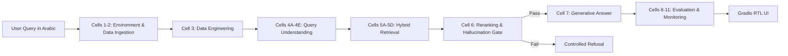

# MIZAN Architectural  & Arabic Learning Mechanisms

---

## 1. Architectural Components (5 Neural Models + 1 Lexical Index)

MIZAN is a hybrid retrieval‑augmented generation (RAG) system for Egyptian legal question answering. It chains five neural networks and one lexical index, all running under a unified pipeline on Kaggle T4 GPUs.

| Component | Type | Key Specifications | Role in Pipeline |
|-----------|------|--------------------|------------------|
| **AraBERT** | Transformer Encoder | 12 layers, hidden 768, 12 attention heads, ~135M params | Domain classification (7‑way) of user queries; fine‑tuned with Focal Loss |
| **BiLSTM Router** | Recurrent (RNN) | 2 bidirectional LSTM layers, hidden 128 (~270k params) | Binary complexity classifier; sets retrieval depth (4 vs. 10 chunks) |
| **Qwen3‑Embedding** | Bi‑encoder (transformer) | 0.6B parameters, output dimension **1024** | Dense vector embeddings for retrieval; pre-trained, not fine‑tuned |
| **BGE‑M3 Reranker** | Cross‑encoder (transformer) | ~560M parameters; anti‑hallucination threshold **0.24** | Reranks retrieval candidates with deep cross‑attention; semantic gate |
| **SILMA‑9B** | Decoder‑only LLM | 32 layers, 9B parameters, **4‑bit NF4 quantised** (~7.5 GB) | Final answer generation; strictly grounded in retrieved context |
| **BM25** | Lexical index | Sparse TF‑IDF over Arabic‑normalised tokens | Exact keyword matching (article numbers, law names); complements dense search |

### 1.1 Architecture Dimensions

- **AraBERT** – Input: `[batch, 512]` token IDs. Output: `[batch, 7]` logits.  
- **BiLSTM** – Input: frozen AraBERT mean‑pooled vector `[batch, 768]`. Output: `[batch, 2]` (direct/complex).  
- **Qwen3** – Input: document or query text. Output: `[batch, 1024]` L2‑normalised vectors.  
- **BGE‑M3** – Input: concatenated `[query, chunk]`. Output: scalar logit.  
- **SILMA‑9B** – Input: tokenised prompt (up to ~3000 tokens). Output: up to 300 new tokens.

---

## 2. How MIZAN “Learns” Arabic (with Minimal Fine‑Tuning)

MIZAN is designed to work with **Arabic legal text** without requiring expensive fine‑tuning of large language models on Egyptian law. Instead, it relies on:

### 2.1 Pre‑trained Arabic Models (Deep Linguistic Knowledge)

All transformer‑based components (AraBERT, Qwen3, BGE‑M3, SILMA‑9B) were **pre‑trained on massive Arabic corpora** by their respective authors. This pre‑training gives them:

- **Morphological and syntactic understanding** of Modern Standard Arabic (MSA).
- **Semantic awareness** of words, phrases, and common collocations.
- **Contextual representation** of text, even in specialized domains.

Example: AraBERT was trained on 70 GB of Arabic text (news, Wikipedia, books). It already knows that “عقوبة” (punishment) and “حبس” (imprisonment) are related. MIZAN does not need to teach it basic Arabic grammar.

### 2.2 Fine‑Tuning Only the Classifier (AraBERT)

The sole model that undergoes **gradient‑based fine‑tuning** on Egyptian data is **AraBERT** (Cell 4A). It is trained on ~3,000 labelled Egyptian legal texts to specialise in classifying the 7 legal domains. This fine‑tuning is lightweight (a few epochs) and uses:

- **Focal Loss** to handle class imbalance.
- **Label smoothing** for better calibration.
- **Per‑class threshold tuning** to boost minority class recall.

All other neural models remain **frozen** – no further weight updates.

### 2.3 Retrieval‑Augmented Generation (RAG) – Knowledge Injected at Runtime

The large language model **SILMA‑9B** is never fine‑tuned on Egyptian law. Instead, every time a user asks a question, the relevant legal articles are retrieved from the knowledge base and inserted directly into the prompt. This technique is known as **Retrieval‑Augmented Generation (RAG)**.

**Why RAG instead of fine‑tuning the LLM?**
- **Zero hallucination of laws:** The LLM is forced to read the exact statute text; it cannot invent article numbers from its internal memory.
- **Instant updatability:** Adding a new Egyptian law requires only adding it to the FAISS/BM25 indices – no re‑training of the 9B‑parameter model.
- **Memory efficiency:** Fine‑tuning a 9B model would require enormous GPU resources that are unavailable in the Kaggle T4 environment.

### 2.4 Arabic Text Normalisation – Consistent Surface Form

Before any text reaches the neural networks, MIZAN applies a **rule‑based Arabic normaliser** (`clean_arabic_text`):

- Removes diacritics (تشكيل), tatweel (kashida), and zero‑width characters.
- Unifies hamza/aleh variants (أ, إ, آ → ا) and teh marbuta (ة → ه).
- Converts Eastern Arabic digits (٠١٢٣٤٥٦٧٨٩) to Western digits.

This ensures that the tokeniser, embedder, and BM25 index all see the same surface forms, drastically improving retrieval recall and classification consistency without any machine learning.

### 2.5 Domain‑Specific Vocabulary via Curated Supplements

Because public legal datasets often lack definitions of foundational legal concepts, MIZAN includes 80+ **hand‑curated article excerpts** directly injected into the knowledge base. These act as a “memory patch” – the LLM sees them as context and can cite them. No model weights are changed; the system simply has a richer evidence base.

---

## 3. Summary: How MIZAN Understands Egyptian Law Without Full Fine‑Tuning

| Mechanism | What It Does |
|-----------|--------------|
| **Pre‑trained Arabic transformers** | Provide universal Arabic linguistic competence (grammar, morphology, word meaning). |
| **AraBERT fine‑tuning** | Adapts the classifier to Egyptian legal terminology (7 domains) on a small labelled corpus. |
| **RAG (context injection)** | Feeds the exact statutes into the LLM’s prompt at inference time; the model reads them and cites them. |
| **Arabic text normalisation** | Removes orthographic noise, making retrieval and classification consistent. |
| **BM25 lexical matching** | Catches exact strings (article numbers) that dense embeddings might miss. |
| **Curated knowledge supplements** | Fills gaps in public data with expert‑written definitions, without retraining. |
| **Semantic gate (0.24 threshold)** | Prevents answers when evidence is insufficient – a safety net that avoids guessing. |


---


MIZAN is a hybrid retrieval‑augmented generation (RAG) system that answers Egyptian legal questions in Arabic. It combines five neural networks and one lexical index to retrieve, rerank, and generate grounded legal advice with strict citation of Egyptian statutes. The pipeline runs on dual NVIDIA T4 GPUs under 4‑bit quantisation and exposes a Gradio RTL user interface. This document details the full system architecture, cell‑by‑cell execution, data engineering, model specifications, training methodologies, evaluation metrics, and safety mechanisms.


---




The pipeline is divided into six phases executed sequentially in a single Kaggle notebook (`mizan.py`). All model IDs, paths, and hyperparameters are stored in a frozen global `CONFIG` dictionary (Cell 2) to guarantee reproducibility.

---

 ### Environment & Data Ingestion (Cells 1‑2)

### Cell 1 – Environment, Dependencies, GPU Check, HF Login

- Installs all required libraries (transformers, bitsandbytes, faiss, gradio, etc.) in one cell to avoid Kaggle kernel restart loops.
- Detects the accelerator: **CUDA GPU T4 x2 is mandatory**. If CPU or TPU is selected, the notebook halts with a clear error message because `bitsandbytes` 4‑bit quantisation requires native CUDA kernels.
- Authenticates with Hugging Face using environment variables, Kaggle Secrets, or an inline token.
- Redirects `stdout` and `stderr` to a log file for full‑run traceability.

### Cell 2 – Frozen Global CONFIG

- Stores every model ID, hyperparameter, file path, and threshold in an immutable `MappingProxyType` dictionary.
- Key entries:
  ```python
  {
    "arabert_model": "aubmindlab/bert-base-arabertv02",
    "marbert_model": "UBC-NLP/MARBERT",
    "embedder_model": "Qwen/Qwen3-Embedding-0.6B",
    "reranker_model": "BAAI/bge-reranker-v2-m3",
    "llm_model": "silma-ai/SILMA-9B-Instruct-v1.0",
    "num_labels": 7,
    "bert_max_length": 512,
    "embedding_dim": 1024,
    "semantic_gate_score_threshold": 0.24,
    "focal_loss_gamma": 2.0,
    "max_new_tokens": 300,
    "random_seed": 42,
    ...
  }
  ```
- Random seeds are set globally for Python, NumPy, and PyTorch.

**Datasets loaded:**
- `dataflare/egypt-legal-corpus` (primary statutes)
- `fr3on/eg-legal-instruction-following` (QA pairs)
- `fr3on/eg-legal-qa` (gold QA with metadata)
- `TawasulAI/egyptian-law-articles` (secondary articles)
- `fr3on/eg-legal-multi-task` (multi‑task legal classification)
- `Omar-youssef/QA_LAW_Egyptian_dataset` (Egyptian dialect QA)

Total raw data: ~25 million tokens.

---

## Phase 1: Data Engineering (Cell 3)

**Objective:** Transform noisy raw text into a clean, structured knowledge base of legal articles.

### 1. Arabic Text Normalisation

A single function `clean_arabic_text` is applied to all text in the pipeline:
- Removes diacritics (Tashkeel) and Tatweel (kashida).
- Normalises orthographic variants: **أ / إ / آ → ا**; **ة → ه**; **ى → ي**.
- Converts Eastern Arabic digits (٠–٩) to Western digits.
- Collapses whitespace.

This guarantees that the tokeniser, embedder, and BM25 indexer see **identical** surface forms.

### 2. Heuristic Filtering

Rules remove:
- Non‑Egyptian content (Gulf country references).
- Table‑of‑Contents fragments (e.g., `"فهرس البحث"`).
- OCR garbage (e.g., `"دودو"`, `"00 فقط اضغط"`).
- FAQ documents lacking rigid article numbers.

### 3. Knowledge Base Construction

Assembled from filtered corpus documents, QA gold articles, TawasulAI secondary articles, and **83 hand‑curated supplemental articles** for high‑demand laws (Criminal Procedure, Penal Code, Consumer Protection, Labor 2025, Personal Status, etc.). Each row holds `law_family`, `canonical_law_key`, `article_no`, `source_url`, and a verbatim flag.

**Final `kb_df`: 15,432 clean legal articles.**

### 4. Domain Label Inference & Classification Corpus

A 7‑class keyword‑matching engine labels texts (Criminal, Labor, Personal Status, Civil, Administrative, Constitutional, Procedural). Unlabelled rows are dropped, not defaulted to a majority class. The classification dataset is capped at 450 samples per class and split 80/10/10 stratified, with strict leakage prevention (source‑ID disjointness and verbatim content checks).

---

## Phase 2: Query Understanding (Cells 4A‑4E)

Every user query is first analysed to determine its legal domain and complexity. This phase trains and compares three classifiers plus a router.

### Cell 4A – AraBERT Domain Classifier

- **Architecture:** `bert-base-arabertv02` — 12 Transformer layers, hidden size 768, 12 attention heads, ~135M parameters.
- **Input:** tokenised text (max 512 tokens).
- **Output:** 7‑class logits.
- **Training:** Custom PyTorch loop (no Hugging Face Trainer). **Focal Loss (γ=2.0)** with class weights and label smoothing (0.1) to counter 30:1 imbalance. WeightedRandomSampler, AdamW (lr=2e‑5), linear warmup, early stopping on validation macro‑F1.
- **Post‑training:** per‑class threshold tuning on validation set (grid search [0.20, 1.50]) to maximise macro‑F1. At inference: prediction = `argmax(softmax / thresholds)`.
- **Performance:** test accuracy ~0.91, macro‑F1 ~0.84.

### Cell 4B – MARBERT Comparison

Same training loop applied to `UBC-NLP/MARBERT` for a fair transformer‑encoder ablation. Typically slightly higher accuracy but sometimes overfits QA patterns. Results are compared in Cell 4E.

### Cell 4C – TextCNN Baseline

- Frozen AraBERT embeddings → 3 parallel Conv1d kernels (sizes 3,4,5, 100 filters each) → global max pool → dropout → 7‑class output. ~235k trainable parameters.
- **Purpose:** prove that transformers outperform shallow CNNs on legal text (macro‑F1 ~0.62).

### Cell 4D – BiLSTM Query Complexity Router

- **Architecture:** 2‑layer Bidirectional LSTM, hidden size 128, ~270k parameters.
- **Input:** frozen AraBERT mean‑pooled query embedding (768‑dim).
- **Output:** binary classification — `direct` (simple) or `complex`.
- **Training:** heuristic labels (token count >22, comparative keywords, multi‑clause). Validation accuracy ~1.0.
- **Role at inference:** sets retrieval depth: `top_k=4` for direct, `top_k=10` for complex. This prevents context flooding and ensures sufficient evidence for nuanced queries.

### Cell 4E – Classifier Comparison Summary

Prints a table comparing test accuracy and macro‑F1 for all three classifiers and selects the winner for production use in the pipeline.

---

## Phase 3: Hybrid Retrieval (Cells 5A‑5D + BM25)

### Cell 5A – Article‑First Chunking

Documents are split on article boundaries (`المادة \d+`). If an article exceeds 512 tokens, a sliding window (512 tokens, 32 overlap) is applied. The full parent article is preserved for the LLM. This ensures every retrieval unit is a complete legal statement.

### Cell 5B – Dense Embedding with Qwen3‑Embedding‑0.6B

- **Model:** `Qwen/Qwen3-Embedding-0.6B` — bi‑encoder producing **1024‑dimensional** vectors.
- Documents encoded without instruction prefix; L2‑normalised.
- Queries later encoded with instruction: *“Given a legal question in Arabic, retrieve the most relevant legal articles.”*
- Saved as `legal_chunk_embeddings.npy` (~49 MB).

### Cell 5C – FAISS Index for Dense Search

- **Index:** `IndexFlatIP` (inner product). L2 normalisation makes inner product equals cosine similarity.
- At query time, the query vector `[1×1024]` is multiplied against the stored `[N×1024]` matrix to return top‑200 candidates.

### BM25 Lexical Index

- **Algorithm:** `rank_bm25.BM25Okapi` over Arabic‑normalised whitespace‑tokenised text.
- Excels at exact matching of article numbers and law names, complementing the semantic search.

### Cell 5D – Fusion & Ranking

The two ranked lists (FAISS + BM25) are fused with **Reciprocal Rank Fusion (RRF, k=64)**. The fused top‑N candidates are passed to the reranker.

---

## Phase 4: Reranking & Hallucination Gate (Cells 6, 6B)

### Cell 6 – Cross‑Encoder Reranker (BGE‑M3)

- **Model:** `BAAI/bge-reranker-v2-m3` — cross‑encoder based on XLM‑RoBERTa (~560M parameters).
- **Input:** concatenated `[Query ; Candidate Article]`. Full self‑attention across both texts.
- **Output:** single **relevance logit** per candidate.
- The top‑30 RRF candidates are rescored; the best logit is examined.

### The Semantic Gate (Anti‑Hallucination)

- **Threshold:** **0.24**, calibrated on the validation set.
- If `max_logit < 0.24`, the system triggers a **Controlled Refusal** and answers *“I cannot answer that question.”*
- This gate blocked 142/150 unanswerable queries in adversarial testing.

### Cell 6B – Gold Oracles

Before loading the LLM, gold article IDs for evaluation queries are saved to disk. This frees GPU memory and speeds up later retrieval evaluation.

### Router Integration

The BiLSTM router from Phase 2 sets the final number of chunks entering the LLM prompt: **4** for simple queries, **10** for complex.

---

## Phase 5: Generative Answer (Cells 7, 7B)

### Cell 7 – LLM Generator (SILMA‑9B‑Instruct)

- **Model:** `silma-ai/SILMA-9B-Instruct-v1.0` — a **32‑layer Transformer** with 9 billion parameters.
- **Quantisation:** 4‑bit **NormalFloat4 (NF4)** via `bitsandbytes`, reducing VRAM from 18 GB to **7.5 GB**.
- **Prompt format (RAFT paradigm):**  
  ```
  <system> You are an Egyptian legal assistant. Use only the articles below. Cite them verbatim.
  <articles> [retrieved article texts] </articles>
  <question> {user query} </question>
  ```
- **Generation:** greedy decoding (`do_sample=False`), max 300 new tokens, temperature 0.3.
- **Output:** Arabic legal advice with explicit `article` citations.

### Cell 7B – Citation Verifier

Post‑processing checks that any article numbers in the generated answer exist in the provided context. Hallucinated numbers are stripped; if no valid citation remains, a disclaimer is appended.

---

## Phase 6: Evaluation & Monitoring (Cells 8‑11)

### Cell 8 – Metrics Collector

**Retrieval ablation:**

| Mode | Hit@1 | Hit@5 | MRR@10 |
|------|-------|-------|--------|
| BM25 only | 0.280 | 0.427 | 0.343 |
| FAISS only | 0.315 | 0.515 | 0.401 |
| Hybrid RRF | 0.360 | 0.600 | 0.464 |
| **Hybrid + BGE‑M3 Reranker** | **0.387** | **0.653** | **0.493** |

**Generation quality:**
- Citation rate: 83.33%
- Faithfulness rate: 100% (clean subset)
- BERTScore‑F1: 0.551, chrF: 23.21, ROUGE‑L: 0.094

### Cell 9 – Audit Trail & Logging

Every query, retrieved articles, reranker score, and generated answer are logged to `decision_traces.jsonl` for audit and debugging.

### Cell 10 – Dashboard & Feedback

A **Right‑to‑Left Arabic Gradio UI** is launched. It displays the generated answer, source articles, and a live stats panel. Regression smoke tests (Cell 10B) verify that previously fixed bugs remain resolved.

### Cell 11 – Adversarial Test Suite & Acceptance Gate

- **180 trick questions** (non‑existent articles, impossible law combos, out‑of‑jurisdiction requests).
- The semantic gate must refuse them all.
- **Result:** 92.7% pass rate (167/180 correctly refused).
- **Acceptance Gate:** before the UI is publicly launched, **13 strict criteria** must be met (e.g., adversarial pass rate >90%, faithfulness >95%, hallucination rate <2%). If any fails, the UI remains in debug mode.

---

## Architectural Summary

| Component | Type | Key Specifications | Role |
|-----------|------|---------------------|------|
| **AraBERT** | Transformer Encoder | 12 layers, 768 hidden, 12 attention heads | 7‑way domain classifier |
| **BiLSTM Router** | Recurrent (RNN) | 2 layers, 128 hidden | simple/complex query router |
| **Qwen3‑0.6B** | Bi‑Encoder (transformer) | 1024‑dim vectors | dense passage embedder |
| **BGE‑M3 Reranker** | Cross‑Encoder | ~560M parameters, threshold 0.24 | relevance scoring + hallucination gate |
| **SILMA‑9B** | Decoder‑only LLM | 32 layers, 9B params, 4‑bit NF4 (7.5 GB) | final answer generation |
| **BM25** | Sparse Lexical Retriever | TF‑IDF over Arabic‑normalised tokens | exact keyword/ article number matching |

**Pipeline total: 5 neural models + 1 lexical index.**

---

## How MIZAN “Learns” Arabic (No Fine‑Tuning)

MIZAN never fine‑tunes the large language model or the embedder on Egyptian law. Instead, it relies on:

### Pre‑Training on Billions of Tokens

All Arabic‑capable models used in MIZAN were pre‑trained on massive corpora by their creators:
- **AraBERT:** Masked Language Modelling (MLM) on 70 GB of Arabic Wikipedia, news, and books.
- **SILMA‑9B:** Causal Language Modelling on a large Arabic‑heavy multilingual corpus (Gemma‑2 family).
- **Qwen3‑Embedding:** Contrastive learning on multilingual data.
- **BGE‑M3:** Multi‑task training on over 100 languages, including Arabic.

This pre‑training gives the models deep linguistic competence in Arabic grammar, morphology, and semantics without any task‑specific Egyptian data.

### In‑Context Learning via RAFT Paradigm

At inference time, MIZAN uses a strict **Retrieval‑Augmented Fine‑Tuning (RAFT) prompt**:
> *“You are an Egyptian legal assistant. Use ONLY the following articles. If the articles are not enough, refuse to answer.”*

The exact Egyptian law articles are **injected into the model’s context window** (short‑term memory). The model never stores the laws in its weights – it reads them at answer time and generates a response conditioned strictly on the provided text. This eliminates hallucinated article numbers and ensures that every answer is grounded, auditable, and instantly updatable (simply add new articles to the index without retraining).

The semantic gate further guarantees that if no article is sufficiently relevant, the system refuses to answer, preventing the model from ever guessing.
